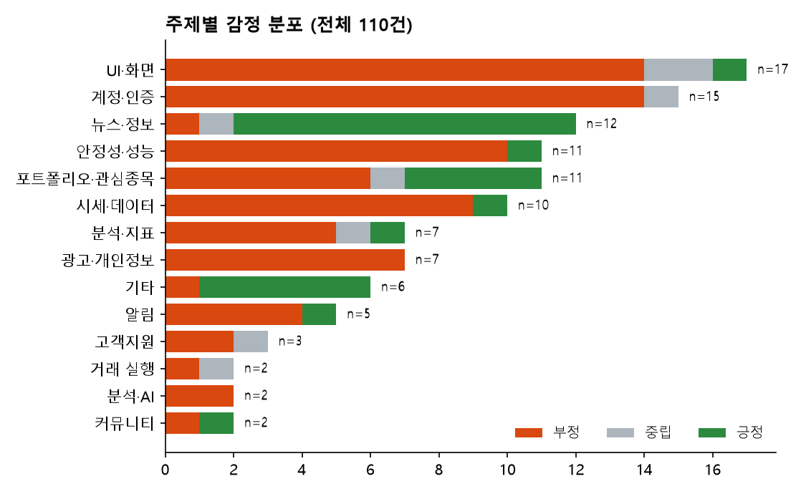
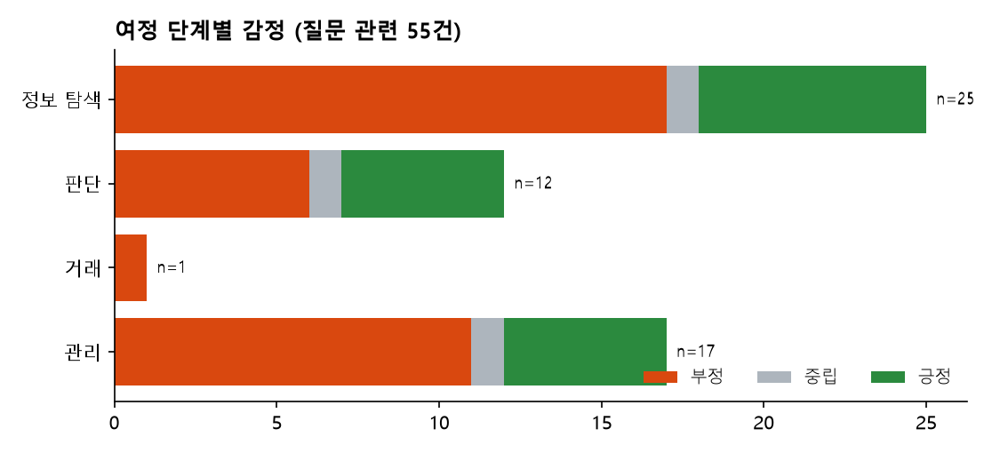
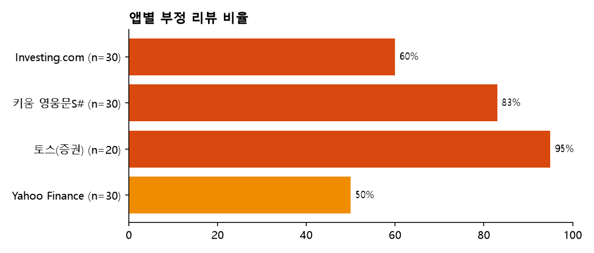

# 기존 주식 서비스 VOC 분석 (Day 04)

**질문:** 개인투자자는 종목 이슈 · 전망 · 포트폴리오를 볼 때 어디서 막히나
**자료:** 4개 앱 리뷰 110건 (2020-12 ~ 2026-11), 질문 관련 55건. 수집·분류 기준은 [review_log.md](review_log.md)
**한계:** 앱 리뷰는 불만이 많이 올라오는 채널이다(부정 77 · 긍정 25 · 중립 8). 분류는 AI가 했고 사람 표본 검사는 아직이다. 칸별 n이 10 미만이면 비율을 인사이트로 쓰지 않는다.

## 차트
| 차트 | 답하는 질문 |
|---|---|
|  | 불만이 몰리는 주제 |
|  | 경험이 꺾이는 단계 |
|  | 앱마다 부정 비율 (토스는 주식 관련 글만 골라 n=20) |

## 숫자로 본 결과
| 항목 | 값 |
|---|---|
| 주제 상위 | UI·화면 17 · 계정·인증 15 · 뉴스·정보 12 · 안정성 11 · 포트폴리오·관심종목 11 · 시세·데이터 10 |
| 질문 관련 단계 | 정보 탐색 25(부정 17) · 관리 17(부정 11) · 판단 12(부정 6) |
| 질문 관련 주제 × 감정 | 뉴스·정보 +10/−1 · 시세·데이터 +1/−9 · 포트폴리오 +4/−6 · 분석(지표+AI) +1/−7 (n=9) · UI −8 |
| 계정·인증 | 15건 중 14건 부정 (1건 중립) |

## 인사이트 3가지
형식: [여정 단계]에서 [주제]에 대한 [감정]이 [빈도]로 나타남 → [서비스 시사점]

1. **정보 탐색 단계에서 시세·데이터에 대한 부정이 10건 중 9건** (종목 검색 누락, 그래프 기간 삭제, 장외 시간 차트 공백, 다른 회사 재무 표시)
   → 우리 화면은 숫자마다 **데이터 기준일 · 출처 · 기간 선택**을 보이게 둔다. 정보의 양(뉴스는 +10)보다 숫자의 신뢰가 문제다.
2. **판단 단계에서 분석(지표·AI)에 대한 부정이 9건 중 7건** (n<10이라 참고용). AI 분석이 "오르면 금리 때문, 내려도 금리 때문"처럼 같은 이유를 양쪽에 쓰고, 악재를 호재로 설명한다는 불만(R064, R077)
   → 가설 2(모델 예측)를 낼 때 **근거와 과거 적중률을 함께** 보이고, 설명이 결과와 반대 방향일 때도 쓸 수 있는 문장은 피한다.
3. **관리 단계에서 포트폴리오·관심종목은 11건 중 6건 부정** (저장 실패, 갱신 안 됨, 손익이 한눈에 안 보임). 그리고 **계정·인증은 15건 중 14건 부정**
   → 가설 3(로그인 없는 포트폴리오)의 근거가 된다. 단, "저장이 확실하고 손익이 한눈에"가 조건이다.

## 가설과의 관계 (Day 11에서 최종 판정)
| 가설 | 오늘 근거 | 상태 |
|---|---|---|
| 1. 관심 회사의 최근 이슈 키워드 | 뉴스 접근 자체는 만족(+10). 이슈를 요약해 달라는 직접 요구는 없음 | 근거 약함 |
| 2. 모델 예측 + 근거 · 적중률 | AI 분석 불신(R064 · R077) | 근거 있음 (조건부) |
| 3. 로그인 없는 포트폴리오 | 계정·인증 부정 14건, 포트폴리오 저장 문제 | 근거 있음 |
