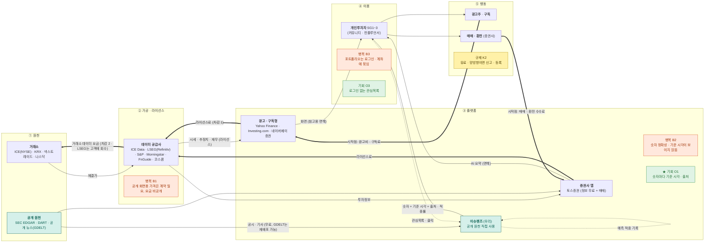

# 산업 밸류체인 맵 v1 — 주식 정보 산업 (기업 6곳 통합)

- 입력: 기업 6곳 원페이지(`research/company/*/onepager.md`), 비교표 [compare.md](../../research/company/compare.md), Day 10 서비스 밸류체인 [v1](../valuechain_v1.md)
- 무엇이 다른가: 서비스 하나가 아니라 **6곳이 같은 줄기의 어느 칸에 서 있는지**를 한 장에 겹쳤다
- 표기: 실선 = 데이터(상품), 굵은 선 = 돈(소비자 → 원천), 점선 = 피드백. 금액은 그림 밖 메모에 출처와 함께
- 태그: [F] 원문 · [I] 해석 · [U] 미확인. 마커 근거는 [analysis.md](analysis.md)
- 상태: **기업 원페이지와 대조 완료, 사람 대조 전**

## 한 줄 요약
데이터는 ① 거래소에서 생겨 ② 공급사를 거쳐야 ③ 플랫폼 화면에 올라갈 수 있고, 돈은 반대로 ⑤ 광고주 · 매매 수수료에서 시작해 ③ → ② → ①로 **두 번 차감되며** 올라간다. 공개 원천(SEC · 공시 · 공개 뉴스)만 이 고리를 거치지 않는다. 이슈렌즈는 그 틈에 선다 [I].

## 단계별 메모 (출처는 각 원페이지)
| 단계 | 누가 | 돈 | 데이터 |
|---|---|---|---|
| ① 원천 | ICE(NYSE) · KRX · 넥스트레이드 · SEC · DART | ICE: 거래소 데이터 · 연결 10.31억 USD(2025) [F] | 체결가는 거래소 소유, 공시 · 공개 뉴스는 누구나 |
| ② 가공 | ICE Data · LSEG · S&P · Morningstar · FnGuide · 코스콤 | LSEG 총수익 89.86억 GBP, 제3자 콘텐츠 회수 3.60억 GBP [F] | 재배포 조건 · 요금은 비공개 계약 [U] |
| ③ 플랫폼 | Yahoo · Investing.com · 네이버 · 토스 · 이슈렌즈 | Yahoo 구독 9.95~49.95 USD/월, 토스 수수료 5,778억 원 [F] | Investing.com "실시간 · 정확 보장 안 함" [F] |
| ④ 이용 | 개인투자자 | 무료 | VOC: 숫자 신뢰 불만이 1위(P1) |
| ⑤ 행동 | 광고주 · 증권사 | 돈의 시작점 | — |
