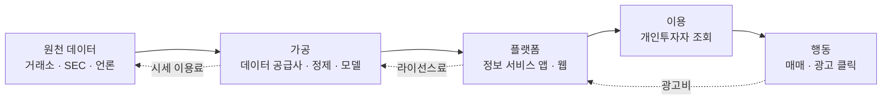

# 밸류체인 v0 — AI 초안 (Day 10 · 4교시 입력)

강의 절차: AI가 Mermaid 초안을 빠르게 그리고(v0), 사람이 정해진 오류 지점(돈 방향 · 출처 없는 숫자 · 빠진 이해관계자)을 검증해 v1로 고친다. 이 파일은 고치기 전 초안이다. 검증 기록은 [analysis.md](analysis.md).

## v0에서 사람이 찾은 오류 (→ v1에서 수정)
1. 돈의 **시작점**이 표시되지 않음 (광고주 · 구독자 · 증권사 중 누구인가)
2. "시세 이용료" 숫자 근거 없음 → Day 9 가격 약관 조사로 확인하거나 [U]
3. 데이터 층이 없음 (어떤 데이터가 누구 손에 있는지, 되돌아가는 피드백)
4. 이 프로젝트(이슈렌즈)가 어느 단계에 들어가는지 표시 안 됨
5. 규제(투자자문 · 유사투자자문)가 걸리는 단계가 없음
