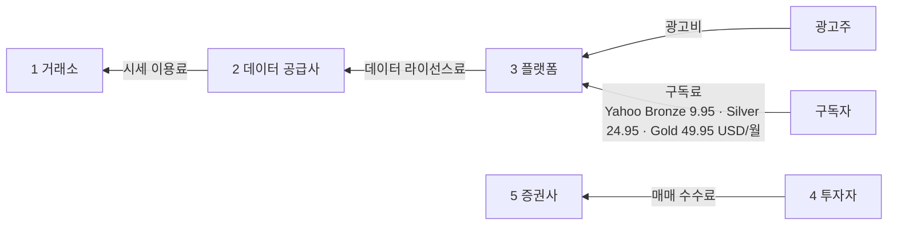
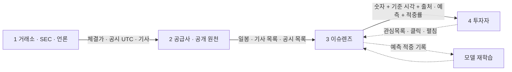
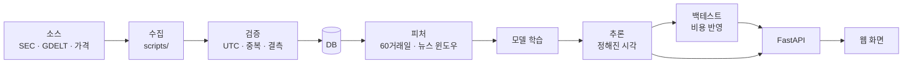

# 밸류체인 맵 v1 — 무료 주식 정보 서비스 (Day 10)

v0(AI 초안)의 오류 5개를 고친 판이다. 네 층(활동 · 이해관계자 · 돈 · 데이터)을 한 줄기에 겹쳤다. 숫자는 출처가 있는 것만 쓰고, 근거는 [analysis.md](analysis.md)에 마커별로 정리했다. 그림: [valuechain_v1.html](valuechain_v1.html)

## ① 활동 · ② 이해관계자
| 단계 | 1 원천 | 2 가공 · 라이선스 | 3 플랫폼 | 4 이용 | 5 행동 |
|---|---|---|---|---|---|
| 활동 | 체결 · 공시 · 기사 발생 | 시세 정제 · 재배포 라이선스 · 추정치 · 모델 | 종목 화면 · 뉴스 · 예측 · 관심목록 | 조회 · 비교 · 판단 | 증권사 매매 · 광고 클릭 · 구독 |
| 하는 사람 | **거래소 · SEC · 언론사** | **데이터 공급사** (ICE · Morningstar · S&P 등, Yahoo 사례) | **정보 서비스** (Yahoo · Investing.com · **이슈렌즈**) | **개인투자자** (SG1~3) | **증권사 · 광고주** |
| (영향 주는 사람) | (거래소 규정) | (공급사 약관: 표시 · 재배포 조건) | (금융위 · 금감원: 자문 · 유사자문 규제) | (커뮤니티 · 핀플루언서) | (광고 네트워크) |

이슈렌즈는 **3 플랫폼** 단계에 들어간다. 2단계(공급사)를 거치지 않고 SEC · GDELT 같은 공개 원천에서 바로 받는 것이 차이다.

## ③ 돈 흐름 (소비자 → 원천 방향)

- **시작점:** 광고주(광고비) · 구독자(구독료). 투자자는 무료 이용자이고, 돈은 5단계(증권사)에서 따로 낸다
- **차감 지점:** 플랫폼 → 공급사(라이선스료), 공급사 → 거래소(시세 이용료). 개인 · 내부용 요금은 Massive 199 · Tiingo 30~50 USD/월이지만 **공개 표시는 안 되고**, 재배포 요금은 공개돼 있지 않다 [U] (price_terms.md)

## ④ 데이터 흐름 (누가 무엇을 가지나)

- **피드백 화살표:** 투자자 행동(관심목록 · 클릭) → 플랫폼, 예측 적중 기록 → 모델. 두 번째가 "맞힌 것과 틀린 것을 같이 보여 준다"는 가치를 데이터로 받친다

## 이슈렌즈 내부 파이프라인 (데이터 흐름의 3단계를 펼친 것)

## 마커 요약 (근거는 analysis.md)
| 종류 | 마커 | 단계 |
|---|---|---|
| 병목 B1 | 화면용 가격 라이선스 없음 | 2 → 3 |
| 병목 B2 | 기사-종목 매핑 잡음 (Apple 0/3) | 2 → 3 |
| 비용 K1 | 가격 데이터 라이선스료 | 3 → 2 |
| 비용 K2 | 규제 대응 (표현 · 고지 · 유료화 시 신고) | 3 |
| 기회 O1 | 숫자마다 기준 시각 · 출처 (P1) | 3 → 4 |
| 기회 O2 | 확률 + 적중률 예측 카드 | 3 → 4 |
| 기회 O3 | 로그인 없는 관심목록 | 4 → 3 |
