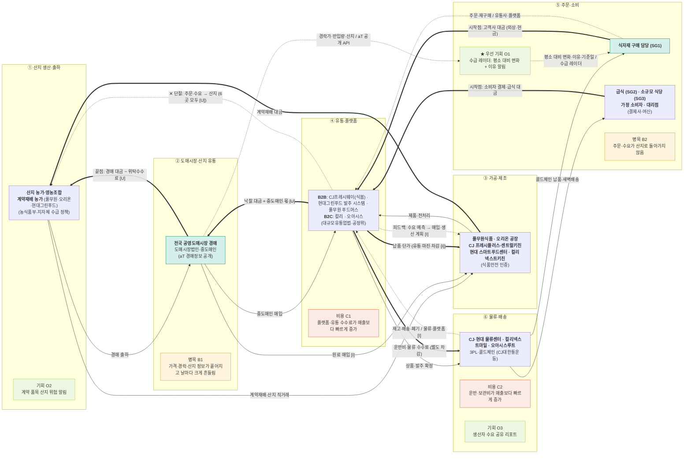

# 산업 밸류체인 맵 v1 — 농식품 공급 산업 (기업 6곳 통합) · 대시보드 데이터 흐름도

- 작성일: 2026-11-09 · 트랙: AX 데이터·서비스 (Day 10 과제 "대시보드 데이터 흐름도")
- 입력: Day 09 원페이지 6곳(`research/company/*/onepager`), Day 10 기업별 맵 6개(`valuechain/*/valuechain_v1.md`), 비교표 [compare.md](../../research/company/compare.md), 수급 레이더 데이터([metrics.csv](../../research/metrics.csv), [data_spec.md](../../research/data/data_spec.md))
- 무엇이 다른가: 기업 하나가 아니라 **6곳이 같은 줄기의 어느 칸에 서 있는지**를 한 장에 겹쳤습니다. 팀 자산(틸)은 수급 레이더의 공공 경매 데이터와 첫 고객 SG1입니다.
- 표기: 실선 = 상품, 굵은 선 = 돈(고객 → 원천), 점선 = 데이터. 금액·비율은 맵에 넣지 않고 아래 메모에 출처와 함께 둡니다.
- 태그: [F] 원문 확인 · [I] 해석 · [U] 미확인. 마커 근거는 [analysis.md](analysis.md).
- 상태: **AI 초안 → 기업별 맵·원페이지와 대조 완료, 사람 대조 전**

## 한 줄 요약

산지에서 식탁까지 여섯 단계 중, **모든 사람이 볼 수 있는 데이터는 ② 도매시장 경매 하나뿐**이고, 주문·수요 데이터는 ④·⑤에 쌓여 ①로 돌아가지 않습니다(6곳 모두 [U]). 6곳의 우선 기회가 모두 "시세 전망·위험 알림·시세 리포트"로 모인 자리가 수급 레이더가 들어갈 칸입니다.

## 네 층 표

| 층 | ① 산지 생산·출하 | ② 도매시장·산지 유통 | ③ 가공·제조 | ④ 유통·플랫폼 | ⑤ 주문·소비 | ⑥ 물류·배송 |
|---|---|---|---|---|---|---|
| **활동** | 재배·수확·출하 결정 | 경매·낙찰·중도매 | 세척·전처리·제품 생산 | 매입·상품 등록·노출·발주 | 비교·발주·결제·메뉴 결정 | 보관·콜드체인·배송 |
| **이해관계자** (하는 사람 · (영향)) | **농가·영농조합·계약재배 농가** · (농식품부·지자체 수급 정책 — 출하 정지 T03) | **도매시장법인·중도매인** · (aT 경매정보 공개) | **풀무원·오리온·CJ 프레시플러스·현대 스마트푸드센터·컬리 넥스트키친** · (식품안전 인증) | **CJ프레시웨이(식봄)·현대그린푸드·푸드머스·컬리·오아시스** · (대규모유통업법) | **식자재 구매 담당(SG1)·급식(SG2)·소규모 식당(SG3)·가정 소비자** · (결제사·여신) | **기업 물류센터·3PL** · (콜드체인 장비) |
| **돈 ⇐** | 끝점: 경매 대금·계약재배 대금 (생산자 몫 [U]) | 위탁수수료·중도매 마진 [U] | 납품 단가 | 유통 마진·플랫폼 수수료 차감 | **시작점**: 고객사 대금·소비자 결제 | 운반비·보관료 (별도 차감) |
| **데이터 ⇢** (이름 / 보유자) | 재배면적·작황 / 통계청 공개 (T05) | **경락가·반입량·산지 / aT 공개 API** ← 팀 자산 | 생산실적·가동률·로트 / 제조사 내부 | 상품·재고·수요 예측 / 플랫폼·유통사 내부 | 주문·재구매·식수 / 유통사·플랫폼 | 배송·재고·폐기 / 물류·플랫폼 [I] |
| **6곳의 자리** | 풀무원·오리온·현대 (계약재배) | 6곳 모두 매입 [I] | 풀무원·오리온 중심, CJ·현대·컬리 일부 | CJ·현대·푸드머스(B2B), 컬리·오아시스(B2C) | CJ·현대 고객=식당·급식, 컬리·오아시스=가정 | CJ·현대·컬리·오아시스 자체 물류 |
| **마커** | 기회 O2 | 병목 B1 | — | 비용 C1 | ★ 기회 O1 · 병목 B2 | 비용 C2 · 기회 O3 |

**피드백 화살표:** ④ → ③ 수요 예측이 매입·생산 계획으로 돌아가는 경로는 있는 것으로 보입니다 [I]. ④ → ① 주문·수요가 산지로 돌아가는 경로는 6곳 모두 확인하지 못했습니다 [U] — 이것이 병목 B2입니다.

## 데이터 흐름도 (대시보드 관점)

신호: 🟩 공급 · 🟧 수요 · 🟦 재고. **공개** = 누구나 받을 수 있음, **내부** = 기업만 보유.

| 단계 | 데이터 | 보유 | 공개 | 신호 | 수급 레이더에서 |
|---|---|---|---|---|---|
| ① | 재배면적·작황 | 통계청 | 공개 | 🟩 | 다음 단계 후보 (T05) |
| ② | 경락가·반입량·산지명 (전국 하루 109,160행, 2026-11-05) | aT | 공개 | 🟩 | **지금 쓰는 데이터** — M1~M5 계산 |
| ③ | 생산실적·가동률 | 제조사 | 내부 | 🟩 | 쓰지 않음 |
| ④ | 상품·재고·수요 예측 | 유통사·플랫폼 | 내부 | 🟧🟦 | 쓰지 않음 |
| ⑤ | 주문·재구매·식수 | 유통사·플랫폼 | 내부 | 🟧 | 구독 이벤트만 (`alert_subscribe`, events.md) |
| ⑥ | 배송·재고·폐기 | 물류·플랫폼 | 내부 | 🟦 | 쓰지 않음 |
| 기상 | 특보·기온 | 기상청 | 공개 | 🟩 | 기회 O2 재료 (M6, API 미시험 [U]) |

## 돈 흐름 메모 (원문 수치만)

| 항목 | 값 | 출처 |
|---|---|---|
| 2025 매출 | CJ프레시웨이 3조 4,811억 · 풀무원 3조 3,802억 · 오리온 3조 3,324억 · 컬리 2조 3,671억 · 현대그린푸드 2조 3,296억 · 오아시스 5,645억 | [compare.md](../../research/company/compare.md) (공시를 억원으로 환산, 계산) |
| CJ프레시웨이 운반비 | 171,115,568 천원 (전기 153,435,879) | CJ [8] L33·L58 ([valuechain/analysis.md](../analysis.md)) |
| 생산자 몫·위탁수수료율·플랫폼 수수료율 | [U] 공개 자료에서 찾지 못함 | — |
