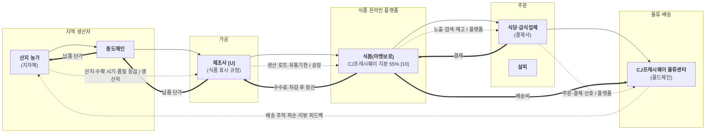

# 밸류체인 맵 v0 — AI 초안 (검증 전)

> **보관용 초안입니다. 발표에 쓰지 마세요.** 슬라이드 17 프롬프트대로 `onepager.html`만 입력으로 삼아 썼습니다.
> 원페이지에 없는 데이터 이름은 수업 템플릿(슬라이드 8)에서 가져왔습니다. 어긋난 항목은 `analysis.md`의 검증 절에 있습니다.

## 단계별 근거

| 단계 | 원페이지 칸 |
|---|---|
| 지역 생산자 | 2 무엇으로(산지 직거래·계약재배), 4 최근 동향(중도매인) |
| 가공 | 없음. 트랙 체인에서 가져옴 |
| 식품 온라인 플랫폼 | 2 어떻게 전달, 마켓보로 지분 KPI |
| 주문 | 2 누구에게, 7 우리 자산 |
| 물류·배송 | 1 기업 개요(물류센터), 2 무엇으로(콜드체인) |
