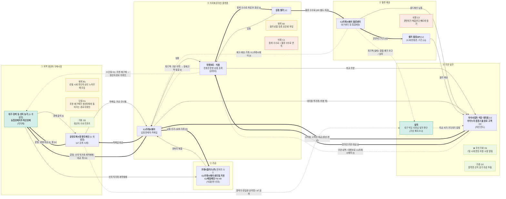

# 밸류체인 맵 v1 — CJ프레시웨이 · 대시보드 데이터 흐름도

- 트랙: AX 데이터·서비스 · 푸드 & 리테일
- 상태: **AI 검증 완료, 팀 결정·사람 대조 전** (`analysis.md` 참고)
- 표기: 실선 = 상품, 굵은 선 = 돈(고객 → 원천), 점선 = 데이터. 맵에는 금액·비율을 넣지 않음.
- 태그: [I] 해석 · [U] 미확인. 출처 번호는 `research/company/CJ프레시웨이/sources.md`, [14-x]는 `analysis.md`의 팀 자료 목록.

## 단계별 근거

| 단계 | 원페이지 칸 | 공시·자료 근거 |
|---|---|---|
| ① 지역 생산자·도매시장 | 2 무엇으로, 4 최근 동향, 지표 후보 표 | [1] L219·L222, [4] L33·L38, [6] L25-L29, [14-b] |
| ② 가공 | 없음. 공시로 보강 | [1] L22·L118·L223, [3] L59·L100-L105, [9] L16·L41 |
| ③ 식자재 온라인 플랫폼 | 2 어떻게 전달, 마켓보로 KPI, 산업 이슈 1 | [3] L262-L285, [4] L25·L38, [10] |
| ④ 주문·발주 | 2 누구에게·어떻게 전달, 7 우리 자산 | [1] L147-L151, [3] L51-L78, [4] L45, [14-c] |
| ⑤ 물류·배송 | 1 기업 개요, 2 무엇으로, 지표 후보 표 | [1] L88-L102, [3] L113·L262·L285, [8] L33 |

**범위 메모** — 푸드서비스(단체급식 운영)는 CJ프레시웨이의 중요한 수익원이지만 이 체인의 화살표 밖입니다 [I]. 맵에는 식자재를 받는 고객 경로로만 표시했습니다.

## 데이터 15칸 (대시보드 데이터 흐름도)

신호: 🟧 수요 · 🟦 재고 · 🟩 공급. 보유자가 공시에 없으면 [I] 또는 [U]로 표시했습니다.

| 단계 | 데이터 이름 | 생성 지점 | 보유자 | 신호 |
|---|---|---|---|---|
| ① | 경락가·반입량·산지명 | 공영도매시장 경매·정산 | aT 공개 API [14-b], 팀 CSV [14-d] | 🟩 공급 |
| ② | 전처리·소스 생산실적·가동률 | 프레시플러스 등 제조 현장 [1] L118-L139 | CJ프레시웨이 [I]. 로트·유통기한 [U] | 🟩 공급 |
| ③ | 상품 목록·규격·SKU | 식봄 상품 등록 [3] L255-L260 [4] L38 | 마켓보로 [I]. 노출·검색 로그 [U] | 🟧 수요 (GMV) |
| ④ | 주문 내역 | 식봄 비교·주문 [4] L45, 오프라인은 ERP [1] L153 [I] | 마켓보로·CJ프레시웨이 [I]. 데이터 권리 [U] | 🟧 수요 |
| ⑤ | 재고·배송 기록 | 물류센터·통합배송 [3] L262 | 1P·2P는 CJ프레시웨이, 3P는 셀러 [I]. CJ대한통운 구간 [U] | 🟦 재고 |

식당 현장의 **결품·폐기·실구매** 기록은 살피 DB에 설계되어 있지만(`stockout_report`, `waste_report`, `receipt_upload` [14-b]) 실제 사장님 기록은 아직 없습니다.

## 돈 흐름 메모 (원문 수치만)

| 항목 | 값 | 출처 |
|---|---|---|
| 식자재유통 매출 (제38기) | 2,612,567 백만원 | [1] L28 |
| 원재료 및 상품매입액 등 | 2,400,607,457 천원 | [8] L17 |
| 운반비 | 171,115,568 천원 (전기 153,435,879) | [8] L33·L58 |
| 지급수수료 | 139,999,311 천원, 세부 내역 [U] | [8] L34 |
| 식봄 중개·물류 수수료, 생산자 몫 | [U] 공개되지 않음 | [3] L269·L283 |
