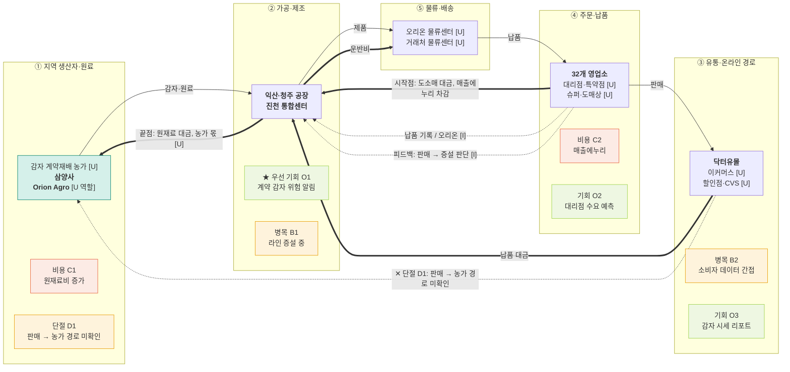

# 밸류체인 맵 v1 — 오리온 · 대시보드 데이터 흐름도

- 트랙: AX 데이터·서비스 · 푸드 & 리테일
- 상태: **AI 검증 완료, 팀 결정·사람 대조 전** (`analysis.md` 참고)
- 표기: 실선 = 상품, 굵은 선 = 돈(고객 → 원천), 점선 = 데이터. 맵에는 금액·비율을 넣지 않음.
- 태그: [I] 해석 · [U] 미확인. 출처 번호는 `research/company/오리온/sources.md`.

## 단계별 근거

| 단계 | 공시·자료 근거 |
|---|---|
| ① 지역 생산자·원료 | [1] L111, L113, [9] L33, [10] |
| ② 가공·제조 | [1] L144-L155, L197-L200, [6], [12] |
| ③ 유통·온라인 경로 | [1] L557, L564-L565, [5] |
| ④ 주문·납품 | [1] L95, L107-L108, L553-L554, L569 |
| ⑤ 물류·배송 | [1] L563, [8] L23, L39 |

**범위 메모** — 해외 법인과 제약·바이오 계열은 이 체인의 화살표 밖입니다 [I]. 맵은 국내 경로 기준입니다. **단계 이름 메모** — 오리온은 플랫폼 운영사가 아니어서 "유통·온라인 경로"로 바꿨습니다.

## 데이터 15칸

| 단계 | 데이터 이름 | 생성 지점 | 보유자 | 신호 |
|---|---|---|---|---|
| ① | 원재료 단가·감자 확보량 | 구매 [1] L111, 계약재배 [10] | 오리온 [I]. 농가별 값 [U] | 공급 |
| ② | 공장별 생산량 | 익산·청주 공장 [1] L144-L155, L197-L200 | 오리온 [I]. 라인별 가동 [U] | 공급 |
| ③ | 채널별 판매 비중 | 판매 비중 [1] L564-L565, 닥터유몰 [5] | 오리온 [I]. 유통사 POS [U] | 수요 |
| ④ | 납품·주문 기록 | 영업소 [1] L553-L554, 거래처 물류센터 L569 | 오리온 [I]. 거래처 재고 [U] | 수요 |
| ⑤ | 재고·출고 기록 | 물류센터·영업소 경로 [1] L563 | 오리온 [I]. 거래처 값 [U] | 재고 |

## 돈 흐름 메모 (원문 수치만)

| 항목 | 값 | 출처 |
|---|---|---|
| 연결 매출 | 3,332,443 백만원 | [15] L42 |
| 별도 매출 | 1,145,838 백만원 | [15] L83 |
| 매출에누리 등 | (131,601) 백만원 | [1] L95 |
| 원재료와 소모품 | 1,395,673,994 천원 | [8] L15 |
| 운반비 | 105,629,067 천원 (전기 102,066,937) | [8] L23, L39 |
| 농가 몫 | [U] 공개되지 않음 | - |
