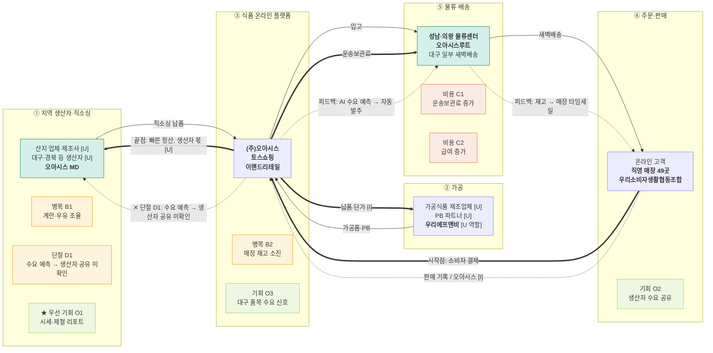

# 밸류체인 맵 v1 — 오아시스 · 대시보드 데이터 흐름도

- 트랙: AX 데이터·서비스 · 푸드 & 리테일
- 상태: **AI 검증 완료, 팀 결정·사람 대조 전** (`analysis.md` 참고)
- 표기: 실선 = 상품, 굵은 선 = 돈(고객 → 원천), 점선 = 데이터. 맵에는 금액·비율을 넣지 않음.
- 태그: [I] 해석 · [U] 미확인. 출처 번호는 `research/company/오아시스/sources.md`.

## 단계별 근거

| 단계 | 공시·자료 근거 |
|---|---|
| ① 지역 생산자·직소싱 | [1] L27, L29, L61, L63 |
| ② 가공 | [1] L49, L63, L68, [9] L20, [10] |
| ③ 식품 온라인 플랫폼 | [1] L22, L108, [11], [12] |
| ④ 주문·판매 | [1] L14, L49, L102-L103, [4] |
| ⑤ 물류·배송 | [1] L16, L25, L226, [8] L35-L36, L49-L50, [11], [12] |

**범위 메모** — 티몬(아고)과 퀵커머스 브이는 이 체인의 화살표 밖입니다 [I]. **비교 메모** — 오아시스는 직영 매장이 있어 컬리와 유형이 완전히 같지 않습니다.

## 데이터 15칸

| 단계 | 데이터 이름 | 생성 지점 | 보유자 | 신호 |
|---|---|---|---|---|
| ① | 상품 매입액·생산자 계약 | MD 직접 계약 [1] L27, 매입 현황 L61 | 오아시스 [I]. 생산자별 값 [U] | 공급 |
| ② | 가공품 상품 기준 | 가공식품 상품 기준 [1] L49 | 오아시스 [I]. 제조사 생산 기록 [U] | 공급 |
| ③ | 구매·회원 기록 | 오아시스마켓 [1] L108, 토스쇼핑 [12] | 오아시스 [I]. 토스 측 [U] | 수요 |
| ④ | 온라인·매장 판매 기록 | 판매채널 [1] L102-L103 | 오아시스 [I]. 세부 공개 [U] | 수요 |
| ⑤ | 재고·피킹·배송 기록 | 오아시스루트 [1] L16, L25, PDA [11] | 오아시스·오아시스루트 [I]. 위탁 구간 [U] | 재고 |

## 돈 흐름 메모 (원문 수치만)

| 항목 | 값 | 출처 |
|---|---|---|
| 매출 | 564,468,852,915 원 | [15] L42 |
| 영업이익 | 19,102,124,581 원 | [15] L43 |
| 상품 매입액 | 395,902,135 천원 | [1] L61 |
| 상품 (비용) | 393,767,982 천원 | [8] L34 |
| 운송보관료 | 34,890,641 천원 (전기 31,301,585) | [8] L36, L50 |
| 생산자 몫 | [U] 공개되지 않음 | - |
