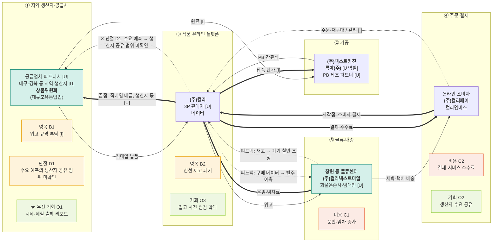

# 밸류체인 맵 v1 — 컬리 · 대시보드 데이터 흐름도

- 트랙: AX 데이터·서비스 · 푸드 & 리테일
- 상태: **AI 검증 완료, 팀 결정·사람 대조 전** (`analysis.md` 참고)
- 표기: 실선 = 상품, 굵은 선 = 돈(고객 → 원천), 점선 = 데이터. 맵에는 금액·비율을 넣지 않음.
- 태그: [I] 해석 · [U] 미확인. 출처 번호는 `research/company/컬리/sources.md`.

## 단계별 근거

| 단계 | 원페이지 칸 | 공시·자료 근거 |
|---|---|---|
| ① 지역 생산자·공급사 | 2 어떻게 전달, 7 접점 | [1] L104, L116, L120, L183, L186, L295 |
| ② 가공 | 4 최근 동향 | [2] L22-L23, [10] L14, L24, L46, [1] L204 |
| ③ 식품 온라인 플랫폼 | 2 무엇을·무엇으로 | [1] L15, L21, L88-L89, [13] |
| ④ 주문·결제 | 2 누구에게 | [1] L106, L119, L123, [8] L45, [12] |
| ⑤ 물류·배송 | 2 무엇으로, 이슈 | [1] L14, L83, L106, L121-L122, [8] L47 |

**범위 메모** — 뷰티·패션은 컬리의 중요한 확장 영역이지만 이 체인의 화살표 밖입니다 [I].

**팀 자산 메모** — 살피의 고객은 식당이라 컬리의 소비자와 다릅니다. 그래서 틸 표시는 지역 생산자(임시)와 영남권 물류 거점에만 했습니다.

## 데이터 15칸

| 단계 | 데이터 이름 | 생성 지점 | 보유자 | 신호 |
|---|---|---|---|---|
| ① | 발주량·입고·상품 검증 기록 | 입고 예약 [1] L183, 가이드 L186, 상품위원회 L295 | 컬리 [I]. 공급사 공유 범위 [U] | 공급 |
| ② | 파트너 생산·납품 계획 | 판매 생산 관리 시스템 [1] L204, 파트너 공장 [I] | 파트너사·컬리 [I]. 공유 범위 [U] | 공급 |
| ③ | 상품·검색·구매 데이터, 수요 예측값 | 컬리 앱·웹 [1] L15, 데이터 조직 L130 | 컬리 [I]. 네이버 측 데이터 [U] | 수요 |
| ④ | 주문·결제·재구매 기록 | 컬리 앱·웹 [1] L106, 컬리N마트 L168 | 컬리·컬리페이 [I]. 네이버 측 [U] | 수요 |
| ⑤ | 재고·입출고·배송 기록 | 통합 물류 운영 [1] L182, 재고 관리 L178, 배송 관제 L189 | 컬리·컬리넥스트마일 [I]. 3PL 화주 값 [U] | 재고 |

## 돈 흐름 메모 (원문 수치만)

| 항목 | 값 | 출처 |
|---|---|---|
| 연결 매출 (제12기) | 2,367,115 백만원 | [1] L96 |
| 상품 판매 | 2,311,448 백만원 | [1] L88 |
| 수수료, 기타 | 48,146 백만원 | [1] L89 |
| 재고자산의 변동과 매입 | 1,578,074,376 천원 | [8] L43 |
| 운반 및 임차료 | 176,194,262 천원 (전기 156,743,435) | [8] L47 |
| 서비스 이용수수료 | 101,805,654 천원 (전기 94,517,768) | [8] L45 |
| 생산자 몫, 3P 수수료율 | [U] 공개되지 않음 | - |
