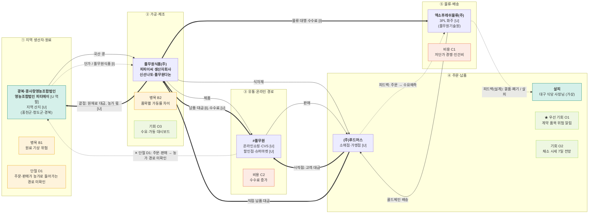

# 밸류체인 맵 v1 — 풀무원 · 대시보드 데이터 흐름도

- 트랙: AX 데이터·서비스 · 푸드 & 리테일
- 상태: **AI 검증 완료, 팀 결정·사람 대조 전** (`analysis.md` 참고)
- 표기: 실선 = 상품, 굵은 선 = 돈(고객 → 원천), 점선 = 데이터. 맵에는 금액·비율을 넣지 않음.
- 태그: [I] 해석 · [U] 미확인. 출처 번호는 `research/company/풀무원/sources.md`.

## 단계별 근거

| 단계 | 원페이지 칸 | 공시·자료 근거 |
|---|---|---|
| ① 지역 생산자·원료 | 2 무엇으로, 산업 이슈 | [1] L74, L569, L576, L591, [9] L31, [11] |
| ② 가공·제조 | 2 무엇으로 | [1] L36, L52, L104-L106 |
| ③ 유통·온라인 경로 | 2 어떻게 전달 | [1] L159-L160, L537, [8] L26, L41 |
| ④ 주문·납품 | 2 누구에게, 7 접점 | [1] L164-L165, L503, [11], [14] |
| ⑤ 물류·배송 | 2 무엇으로, 이슈 | [1] L167-L168, L509, L553, [12] |

**범위 메모** — 식품서비스유통(구내식당·휴게소·컨세션)과 해외 부문, 건강케어는 이 체인의 화살표 밖입니다 [I].

**단계 이름 메모** — 트랙 기본 체인의 "식품 온라인 플랫폼"은 풀무원이 플랫폼 운영사가 아니어서 "유통·온라인 경로"로 바꿨습니다.

## 데이터 15칸

| 단계 | 데이터 이름 | 생성 지점 | 보유자 | 신호 |
|---|---|---|---|---|
| ① | 원료 매입 단가·계약재배 면적 | 국산 콩 매입 [1] L74, 계약재배 [11] | 풀무원식품 [I]. 농가별 값 [U] | 공급 |
| ② | 품목별 생산량·가동률 | 생산자회사 공장 [1] L104-L106 | 풀무원 [I]. 로트 [U] | 공급 |
| ③ | 상품 목록·온라인 판매 | #풀무원 [1] L537, 신경로 L160 | #풀무원은 풀무원 [I]. 외부 플랫폼 로그 [U] | 수요 |
| ④ | 주문·납품 실적 | 푸드머스 디지털 주문 [1] L503, 직납·FC L159-L161 | 풀무원식품·푸드머스 [I]. 소매 POS [U] | 수요 |
| ⑤ | 재고·온도·배송 기록 | 물류센터 [1] L509, WRMS [12] | 엑소후레쉬물류·풀무원 [I]. 협력사 값 [U] | 재고 |

## 돈 흐름 메모 (원문 수치만)

| 항목 | 값 | 출처 |
|---|---|---|
| 연결 매출 (제42기) | 3,380,189 백만원 | [1] L152 |
| 생산자회사 내부거래 매출 | 548,536 백만원 | [1] L52 |
| 상품의 판매 | 1,405,245,433 천원 | [8] L18 |
| 원재료와 저장품의 사용액 | 369,334,932 천원 | [8] L17 |
| 물류비와 관리비 | 243,631,127 천원 (전기 234,813,408) | [8] L21, L36 |
| 지급수수료 | 333,535,370 천원 (전기 306,530,916), 세부 [U] | [8] L26, L41 |
| 농가 몫, 플랫폼 수수료 | [U] 공개되지 않음 | - |
