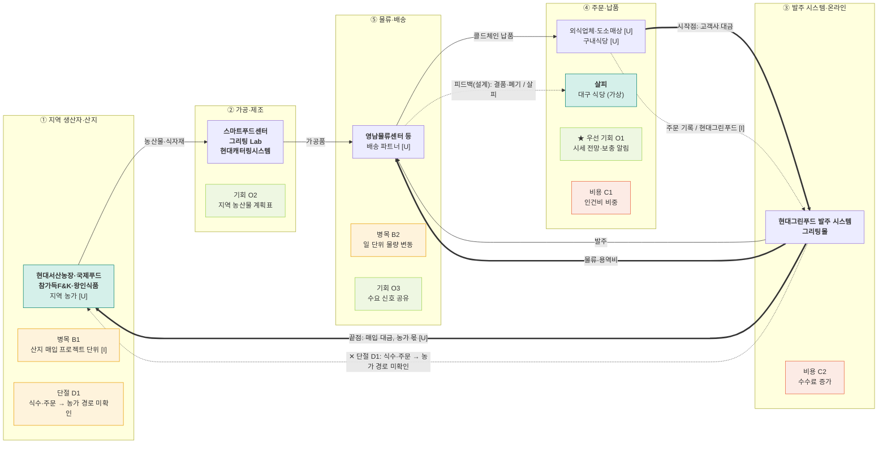

# 밸류체인 맵 v1 — 현대그린푸드 · 대시보드 데이터 흐름도

- 트랙: AX 데이터·서비스 · 푸드 & 리테일
- 상태: **AI 검증 완료, 팀 결정·사람 대조 전** (`analysis.md` 참고)
- 표기: 실선 = 상품, 굵은 선 = 돈(고객 → 원천), 점선 = 데이터. 맵에는 금액·비율을 넣지 않음.
- 태그: [I] 해석 · [U] 미확인. 출처 번호는 `research/company/현대그린푸드/sources.md`.

## 단계별 근거

| 단계 | 공시·자료 근거 |
|---|---|
| ① 지역 생산자·산지 | [1] L50-L53, L347-L348, [5], [10] |
| ② 가공·제조 | [1] L69, L129, L280, L362 |
| ③ 발주 시스템·온라인 | [1] L132, L359, [5], [8] L21, L32 |
| ④ 주문·납품 | [1] L124-L125, L135, [8] L17, [14] |
| ⑤ 물류·배송 | [1] L60-L67, L362, [3] |

**범위 메모** — 해외 급식과 유통 사업은 이 체인의 화살표 밖입니다 [I]. **단계 이름 메모** — 현대그린푸드는 온라인 플랫폼 운영이 중심이 아니어서 "발주 시스템·온라인"으로 바꿨습니다.

## 데이터 15칸

| 단계 | 데이터 이름 | 생성 지점 | 보유자 | 신호 |
|---|---|---|---|---|
| ① | 품목별 매입 단가·매입처 | 구매 [1] L50-L53, 산지 직거래 L347-L348 | 현대그린푸드 [I]. 농가별 값 [U] | 공급 |
| ② | 생산·위생 기록 | 스마트푸드센터 [1] L69, L129, 가공센터 L362 | 현대그린푸드 [I]. 로트 [U] | 공급 |
| ③ | 고객사 발주 기록 | 시스템 발주 [1] L132 | 현대그린푸드 [I]. 그리팅 로그 [U] | 수요 |
| ④ | 주문·식수 기록 | 고객사 발주 [1] L132, 구내식당 피플카운팅 [13] | 현대그린푸드 [I]. 고객사 값 [U] | 수요 |
| ⑤ | 재고·배송·온도 기록 | 물류센터 [1] L60-L67, 차량 GPS·온도 L362 | 현대그린푸드 [I]. 위탁 구간 [U] | 재고 |

## 돈 흐름 메모 (원문 수치만)

| 항목 | 값 | 출처 |
|---|---|---|
| 매출액 | 2,329,622,621 천원 | [15] L46 |
| 식재사업 매출 | 589,522 백만원 | [1] L18 |
| 상품매출원가 | 655,671,299 천원 | [8] L14 |
| 종업원급여 | 605,558,612 천원 | [8] L17 |
| 지급수수료 | 76,898,769 천원 (전기 69,146,305) | [8] L21, L32 |
| 농가 몫 | [U] 공개되지 않음 | - |
